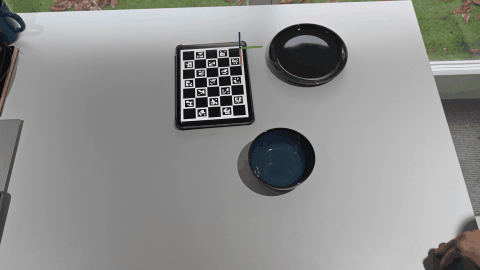
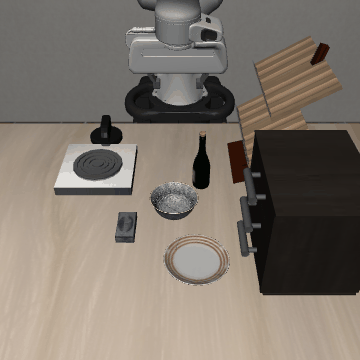
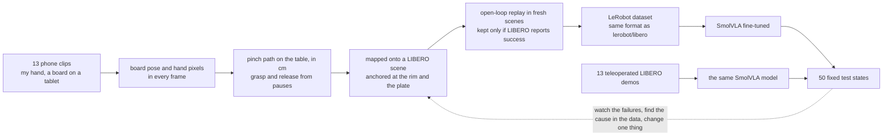
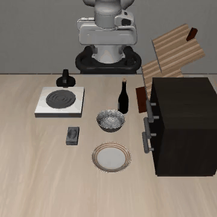
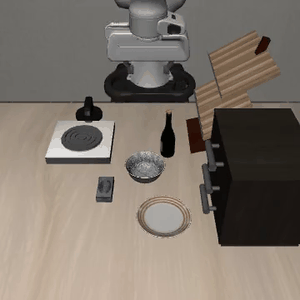
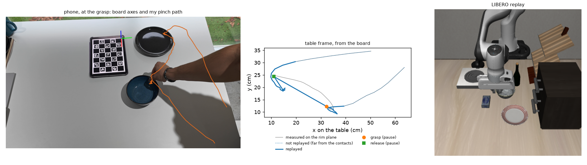
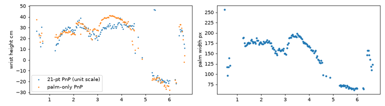

# phone-to-panda

I filmed my own hand putting a bowl on a plate, with a phone held in my other
hand, and used those clips to make a Panda arm do the same task in LIBERO
("put the bowl on the plate", LIBERO-Goal). Each clip is reconstructed on the
table in centimetres, mapped onto the simulated scene, and replayed open loop
in several LIBERO scenes; the replays that succeed become training data for
SmolVLA, compared against the same number of LIBERO's own teleoperated
demonstrations. The best policy trained only on my clips solves 70 of 150
test episodes (the 50 test states, evaluated three times: 23, 25 and 22); the
same model trained on 13 teleoperated demos solves 46 of 50 (both predicting
again every 10 actions).

The phone policy learns from my clips alone: no LIBERO demonstration goes into
its training data, nothing in the videos is labelled by hand (the phone is
calibrated, grasp and release come from the motion), and the evaluation is
LIBERO's own task with its 50 fixed test states, in a kitchen scene with five
other objects on the table. The trained policy, its dataset and the clips are
in the [release](https://github.com/andrealo20/phone-to-panda/releases/tag/v2).

| | |
|---|---|
|  |  |
| demo_020 on my table, with the board axes and the tracked thumb and index tips | the same clip replayed in LIBERO |

[Approach](#approach) · [Results](#results) · [How it works](#how-it-works) ·
[Ablation](#ablation) · [What did not work](#what-did-not-work) ·
[Limitations](#limitations) · [Running it](#running-it)

## Approach



- The question is whether clips of my own hand, filmed with a phone, can
  stand in for teleoperated demonstrations when fine-tuning a VLA. It is
  measured on one LIBERO task, against the same model trained on the same
  number of LIBERO's own teleoperated demos, on the task's 50 fixed test
  states.
- The phone gives pixels and the robot needs actions. I turn each clip into
  robot actions in simulation and let LIBERO's own success check decide which
  replays become training data. The policy then learns from ordinary robot
  data, and everything specific to my clips sits in the conversion.
- The conversion measures what it can and states what it assumes: scale from
  a board of known square size on a tablet, depth from the plane of the bowl's
  rim, grasp and release from where the hand stops. The hand's height is set
  by a rule. Each measured piece is checked against a known answer in the
  tests.
- From there I changed one thing at a time, each time after watching the
  previous policy fail and finding the cause in the data. In the second round,
  changes were screened and checkpoints chosen on freshly sampled scenes, and
  the 50 test states were used once per model.

## Results

Same model throughout (SmolVLA fine-tuned from `lerobot/smolvla_base`, batch
32, seed 0), evaluated on the 50 fixed initial states of the task, either
executing each predicted 50-action chunk whole (LeRobot's default) or
predicting again every 10 actions.

| Training data | Replays kept | Training steps | Success /50, whole chunks | Success /50, every 10 actions |
|---|---|---|---|---|
| 13 teleoperated LIBERO demos | | 4k | **42** | **46** |
| 13 phone clips, wrist turned towards my grasp side | 66 of 104 | 4k | 0 | |
| 13 phone clips, wrist kept at rest | 40 of 104 | 4k | 3 | |
| 13 phone clips, wrist at rest, approach cut to the last 10 cm | 64 of 104 | 4k | 9 | 6 |
| the 13 teleoperated demos and those 64 replays together | | 4k | 8 | |
| 13 phone clips, 16 replays kept per clip, shorter carry | 181 of 367 | 8k (of 20k) | 11 | **23** (then 25, 22) |
| the same with twice as many replays | 372 of 725 | 16k | 13 | 10 |

95% intervals: 42 of 50 is 71 to 92%, 46 is 81 to 97%, 9 is 10 to 31%. The
best phone checkpoint was evaluated three times on the test states, with
different seeds for the policy's sampling: 70 of 150, 39 to 55%. Between the
other phone rows, a few successes either way mean nothing.

### First round: 0% to 18%

The first three phone rows are in the order I ran them. Each change came from
watching the previous policy fail and finding the cause in the data:

- **0%:** the policy hovered over the bowl and pushed it. My replays turned
  the gripper to close on whatever side of the bowl my hand had come from, so
  the wrist angle in the training data varied all around the bowl (spread up
  to 0.67 rad in the state's orientation, against at most 0.15 in the
  teleoperated data, where the wrist never turns). With 66 episodes the policy had to learn both
  where to grasp and how far to turn.
- **6%:** with the grasp side snapped to the two sides the Panda reaches
  without turning its wrist, the policy circled the bowl and came down next to
  the cream cheese. It was copying my detours: the replays started from
  wherever my hand entered the frame, so the robot took 165 steps where the
  teleoperators take 91, and the grasp came at step 83 instead of 36.
- **18%:** replaying only my last 10 cm before the grasp and the first 10 cm
  after the release, and starting from the robot's own home pose, the policy
  goes to the bowl and completes the task 9 times.

SmolVLA predicts 50 actions at a time and by default executes all of them
before looking again. Predicting again every 10 actions (`n_action_steps=10`)
moved the teleoperated policy from 42 to 46 and this phone policy from 9 to
6, both within the noise. The episode-by-episode outcomes say more: the
teleoperated policy solves the same 40 initial states in both runs, while of
the 14 states the phone policy solves in either run, only one is solved in
both. Its successes do not come from a few easy scenes; they come and go with
when it replans.

Adding my replays to the teleoperated demos does not help. Trained on both
(stored as lossless images, so the pixels are exactly those of the separate
runs), the policy solves 8 of 50, about as many as with my replays alone. By
frame count the replays are 88% of that dataset (9071 of 10320), so they are
most of what the policy learns from. In the failed episodes I watched it
lifts the bowl and then sets it down short of the plate or beside it, once
knocking over the wine bottle. The 8 states it solves are all among the 42
the teleoperated policy solves. Giving the two sources equal weight in the
batches is the run I would try next.

### Second round: 18% to 46%

The policy was far worse than its own training data (replayed open loop, the
same clips succeed 71% of the time, see the ablation), so I compared my
replays with the teleoperated episodes in what the policy learns from:

| | teleoperated | my replays |
|---|---|---|
| carry, recorded steps (median) | 48 | 84 |
| rotation command during the carry, largest axis (mean, normalised) | 0.05 | 0.23 |
| replays kept per clip | | 0 to 8 |
| training loss at 4000 steps | 0.054, flat | 0.133, still falling |

Two replay changes were screened on 52 freshly sampled scenes before any
training. Commanding only the heading and letting the wrist tilt, as the
teleoperators' small rotation commands suggest, shortens the carry to theirs
(47 steps) but drops the replays from 29 to 10 successes: in the replay I
rendered, the gripper tilted to 61 degrees under the bowl and the arm folded.
The tilt correction stays. Squeezing the carry into at most 40 steps keeps 29
and cuts its still steps from 24 to 17, so it stays too.

What moved the result was more data, balanced across clips, and longer
training. Each clip was replayed until 16 replays were kept (181 in all;
demo_002 and demo_019 stopped at 10 after 40 attempts, demo_024 at 1), and
SmolVLA trained for 20,000 steps. I chose the checkpoint on 50 freshly sampled
scenes (19, 30, 25, 25 and 24 of 50 at 4k to 20k steps), then evaluated it
once on the test states: 23 of 50 predicting again every 10 actions, 11
executing whole chunks. Of the 5 failures among the 10 test episodes with
video, 3 bring the bowl to the plate, leave it on the rim or beside it and run
out of the 300 steps trying again; 1 goes to the plate without the bowl; 1
twists the wrist over the bowl and never holds it.

Twice as many replays did not help: 31 of 50 on fresh scenes, level with the
181, but 10 and 13 on the test states.

The best checkpoint holds up when evaluated again: with two more seeds for
the policy's sampling it solves 25 and 22 of the 50 test states, 70 of 150 in
all. 12 states are solved all three times, 15 never. What I cannot explain is
the gap between scene sets: the two chosen checkpoints solve 30 and 31 of 50
fresh scenes but between 10 and 23 of the test states, and the same checkpoint
gives 23 or 11 depending only on how often it replans. The object layouts of
the two scene sets match; the robot's start differs by about 1 cm, but success
does not track that offset.

| | | |
|---|---|---|
|  |  |  |
| trained on my clips (181 replays), success | same policy, failure | trained on 13 teleoperated demos |

## How it works



### A tablet as the ruler

Code: [board.py](src/p2p/board.py), [camera.py](src/p2p/camera.py),
[calibrate.py](scripts/calibrate.py)

A ChArUco board shown full screen on an iPad lying flat on the table defines
the table frame. Its square size is measured once with a ruler (31 mm), so
every frame of every clip gets a metric camera pose, and the phone can move
freely while I record. Two calibration clips on different days agreed on the
focal length to 0.1% (1778 vs 1780 px); I kept the one with more viewing
angles. Board reprojection error over the 26 clips is 0.09 to 0.15 px.

### The hand gives a pixel, the table gives the depth

Code: [hand.py](src/p2p/hand.py), [track.py](scripts/track.py),
[retarget.py](src/p2p/retarget.py)

MediaPipe finds the hand; I use only the 2D midpoint of thumb and index
fingertips. Its depth comes from the table: the camera ray through that pixel
is cut with the horizontal plane at the bowl rim's height (bowl height minus
1 cm, measured with the ruler). That is exact whenever the fingers are on the
rim, which is when it matters.

### Grasp and release from the motion

Code: [retarget.py](src/p2p/retarget.py)

The thumb-index distance is too noisy to say when the fingers close (the
fingertips are inside the bowl). The motion is not: the bowl only moves while
it is held, so the grasp and release are the last two places where the hand
stops, with the carry in between. Pauses closer than 4 cm are one place, which
absorbs tracking noise and small finger adjustments on the rim. A carry
shorter than 12 cm means the pauses were misread (in the usable clips the
bowl travelled 18 to 49 cm), and the clip is dropped.

### What the robot replays

Code: [retarget.py](src/p2p/retarget.py), [sim_map.py](src/p2p/sim_map.py)

- Approach and retreat: my hand's path within 10 cm of the grasp and of the
  release, cut at the height the robot will replay rather than at the rim, so
  a raised hand is not projected too far. Farther out my path only says where
  I was standing; the robot comes straight from its home pose.
- Carry: a straight line from the grasp point to the release point, over the
  same duration as mine. While I hold the bowl my hand is well above the rim,
  at a height the phone cannot see, and the measured path is not reliable
  (see below). The two end points are.
- Height: not measured. The gripper rises with horizontal distance from the
  nearest contact point, three times as fast as it moves sideways, up to 10 cm.

### From my table to LIBERO's

Code: [sim_map.py](src/p2p/sim_map.py), [sim.py](src/p2p/sim.py)

Bowl and plate look the same from every side, so the task does not change if
the demonstration is rotated about the bowl. The replay is rotated so that my
carry direction matches LIBERO's bowl-to-plate direction, then pinned at two
points: the grasp lands on the simulated rim and the release leaves the bowl
centred on the plate. In between the shift blends with the distance carried,
so the robot does not slide while its fingers close.

A rim grasp only needs the fingers to close across the wall. The grasp side is
the side my hand came from, snapped to the nearer of the two sides the Panda
reaches with its wrist at rest. The demonstration can also be mirrored across
the carry axis without changing the task; my table was empty and LIBERO's has
a wine bottle next to the bowl, so of the two mirror images the replay uses the
one whose open fingers stay farther from the other objects.

Two playback rules come from the robot, not from me: the gripper switches when
the robot's fingers reach the contact point (at most 1 s of waiting), and it
then holds still for half a second, because the Panda's fingers close much
slower than mine.

### Replayed demos as training data

Code: [generate.py](scripts/generate.py), [sim.py](src/p2p/sim.py)

In the first round each usable clip was replayed in 8 freshly sampled LIBERO
scenes; in the second, until 16 replays were kept (at most 40 attempts), so
that no clip dominates. LIBERO's own success check decides which replays
become training episodes, recorded in the exact format of the `lerobot/libero`
dataset (camera orientation, state vector and action convention checked
against it). Evaluation uses LIBERO's 50 fixed
initial states, which the replays never saw.

## Ablation

What each decision in the replay is worth, without any learning: the 13
usable clips replayed open loop in the first 4 fixed LIBERO states (52 runs
per row), with one decision switched off at a time. Every row uses the same
clips and states, but 52 runs is still few: I read only the large gaps, and a
difference of a handful of runs means nothing.

| Replay | Success (of 52) |
|---|---|
| full method | **37** (71%) |
| no half-second pause for the fingers | 15 (29%) |
| my whole approach path, not just the last 10 cm | 21 (40%) |
| descent at 45 degrees instead of three times steeper | 24 (46%) |
| measured carry path instead of the straight line | 26 (50%) |
| gripper switching on my clock, not on arrival | 27 (52%) |
| rays cut at the rim plane instead of the replay height | 33 (63%) |
| no mirror image | 37 (71%) |
| wrist turned towards my grasp side | 48 (92%) |

The replay works because of decisions that are not in my hand's motion.
Without the half-second pause for the fingers it drops from 37 to 15
successes; replaying my whole approach instead of the last 10 cm, to 21; a
45-degree descent instead of a steep one, to 24.

Two rows say something beyond "this helps". The mirror image no longer changes
anything once the grasp side is snapped. I added it earlier, when on one clip
the open fingers jammed against the wine bottle and mirroring cleared them; I
never measured it on its own before the snapping made it redundant. And turning the
wrist towards my grasp side makes the replay itself more reliable (92%) while
producing the training data the policy could not learn from at all (0 of 50
above). An open-loop replay that works is not the same thing as a good
demonstration.

## What did not work

**Hand depth from MediaPipe.** MediaPipe also predicts 3D hand landmarks;
solving PnP between them and the 2D ones gives a depth for the hand. On my
clips the pinch height came out as low as 40 cm *below* the table. The camera
sees the back of the hand and the fingertips are hidden in the bowl, so the 3D
landmarks are guesses (PnP residual 25 to 45 px on a hand 160 px wide). PnP on
the palm alone (wrist and knuckles, which stay visible) halved the frame to
frame noise but kept the same failure: when I turn my hand to set the bowl
down, the palm seen edge on goes from 175 to 70 px wide and the depth doubles.



**Pauses from the palm.** To make the pause detection less sensitive to the
jittery fingertips I tried detecting pauses from the palm instead. Usable clips
went from 13 to 9: the palm is about 8 cm above the rim, and on the rim plane
every turn of the wrist moves it.

**The measured carry path.** With the carry taken from the video, the replay
overshot the plate on several clips (25 cm on one) and dragged the bowl over
the plate's rim; in the ablation it costs 21 points.

**Evaluating at the training resolution.** LeRobot renders the LIBERO
cameras at 360x360 by default, while all the training data, mine and the
teleoperated, are 256x256. Evaluating at 256 gave 10 of 50 for the 18% phone
policy and 36 of 50 for the teleoperated one: no gain, so every number above
uses the default.

**Framing.** Of the 26 clips I recorded, 13 are usable. In the first batch I
filmed from too far and too low; the bowl and my hand left the frame when I
lifted it, and the hand was lost exactly at the pauses. After moving the phone
closer and higher, 6 of 9 clips passed. The three that still failed have the
hand in view but pauses too short to stand out from fingertip jitter.

## Next

- Noise in the replays. The servo follows each path exactly, so the policy
  never sees how to recover from a deviation, and 3 of the 5 recorded failures
  are a bowl left on the rim with no recovery. Perturbing the commanded path
  during generation, as in DART, would put corrections into the data.
- The teleoperated baseline at the same 20,000 steps, for an equal-budget gap.
- A scripted control: straight-line pick and place replayed and trained the
  same way, to separate what the pipeline limits from what my clips add.

## Limitations

- One task and one training seed per row. The best phone checkpoint was
  evaluated three times (70 of 150, 39 to 55%); every other row rests on a
  single 50-episode evaluation.
- The teleoperated baseline trained for 4,000 steps, the best phone policy for
  20,000 (checkpoint chosen at 8,000). I did not rerun the baseline with the
  longer budget, so the gap between the two is not measured at equal training.
- In the first round every choice was made watching evaluations on the same
  50 test states, and the ablation uses 4 of them, so those rows have no
  untouched test set. From the second round, replay variants were screened and
  checkpoints chosen on freshly sampled scenes.
- The mapping relies on bowl and plate being round. An object with a front
  and a back would need its own orientation from the video, which this
  pipeline does not estimate.
- My hand's height is never measured. What survives from each clip is the
  path near the contacts, the side of the grasp (snapped to two options), the
  timing and the carry duration.
- Turning a clip into training data uses the simulator's object positions,
  which the policy never sees; the policy itself sees only the cameras and the
  robot state.
- Half of my clips were unusable, almost all from framing. The protocol in
  [docs/recording.md](docs/recording.md) is the version that worked.

## Running it

Linux only (LIBERO). Python 3.12, an NVIDIA GPU for training. One GPU job at a
time: generation, training and evaluation all render with EGL, and four at
once crashed WSL. On the laptop I used (RTX 4080 Laptop, 12 GB, under WSL) a
replay takes about 46 s, a training step at batch 32 about 1.04 s (20,000
steps in 5 h 45 min) and an evaluation of 50 episodes about 17 min.

```bash
sudo apt install libegl1 libgles2
bash scripts/setup_env.sh
source ~/venvs/phone-to-panda/bin/activate
```

The repo has everything measured from my clips except the video itself: the
session's measurements and the phone calibration (`data/raw/s01/*.json`) and,
for every frame of every clip, the hand landmarks in pixels and the board pose
(`data/cache/s01/demo_*.npz`, 1.3 MB). That is enough for every step from
`retarget.py` on. The 26 clips and the calibration video (audio and location
removed) are a release asset, needed only for the calibration, the tracking
and the overview figure:

```bash
curl -LO https://github.com/andrealo20/phone-to-panda/releases/download/v2/s01_clips.zip
unzip s01_clips.zip -d data/raw
python scripts/calibrate.py data/raw/s01
python scripts/track.py data/raw/s01 --overlay
```

To check the main result without training, the release has the chosen
checkpoint (900 MB) and the dataset it was trained on (190 MB, 181 replays):

```bash
curl -LO https://github.com/andrealo20/phone-to-panda/releases/download/v2/smolvla_phone_bal16_8k.zip
unzip smolvla_phone_bal16_8k.zip -d ~/runs
bash experiments/eval.sh ~/runs/phone_bal16_20k 008000 10   # 23 of 50 with seed 1000
curl -LO https://github.com/andrealo20/phone-to-panda/releases/download/v2/phone_bal16.zip
unzip phone_bal16.zip -d outputs/datasets                    # train on it without generating
```

From the measured data on (recording your own clips: [docs/recording.md](docs/recording.md)):

```bash
python scripts/retarget.py data/raw/s01
python scripts/generate.py data/raw/s01 --per-demo 8 --out outputs/datasets/phone_all
bash experiments/train.sh teleop
bash experiments/train.sh phone
python scripts/mix_datasets.py 13 && bash experiments/train.sh mixed
bash experiments/eval.sh ~/runs/teleop13
bash experiments/eval.sh ~/runs/phone13
bash experiments/eval.sh ~/runs/mixed13
bash experiments/eval.sh ~/runs/teleop13 last 10   # replanning every 10 steps
bash experiments/eval.sh ~/runs/phone13 last 10
python scripts/ablate.py data/raw/s01
# second round
python scripts/screen_servo.py
python scripts/generate.py data/raw/s01 --keep 16 --max-tries 40 --seed 1 --carry-steps 40 --out outputs/datasets/phone_bal16
PHONE=phone_bal16 RUN=phone_bal16_20k STEPS=20000 bash experiments/train.sh phone
for c in 004000 008000 012000 016000 020000; do DEV_SEED=10000 bash experiments/eval.sh ~/runs/phone_bal16_20k $c 10; done
bash experiments/eval.sh ~/runs/phone_bal16_20k 008000 10
bash experiments/eval.sh ~/runs/phone_bal16_20k 008000
for s in 2000 3000; do EVAL_SEED=$s bash experiments/eval.sh ~/runs/phone_bal16_20k 008000 10; done
python scripts/generate.py data/raw/s01 --keep 16 --max-tries 40 --seed 2 --carry-steps 40 --out outputs/datasets/phone_bal16b
lerobot-edit-dataset --new_repo_id local/phone_bal32 --new_root outputs/datasets/phone_bal32 --operation.type merge \
  --operation.repo_ids "['local/phone_bal16','local/phone_bal16b']" \
  --operation.roots "['outputs/datasets/phone_bal16','outputs/datasets/phone_bal16b']"
PHONE=phone_bal32 RUN=phone_bal32_16k STEPS=16000 bash experiments/train.sh phone
python scripts/render_replay.py data/raw/s01 demo_020 --state 1
python scripts/figures.py data/raw/s01 demo_020 --sim outputs/figures/demo_020_sim.png
python scripts/make_gifs.py
```

`python scripts/sim_smoke.py 20` checks the simulator side alone with a
hand-made trajectory, no phone data needed. `pytest` runs the tests; each one
checks a piece against a known answer: synthetic camera views for the board
pose and the calibration, rays from known points, pause and contact detection
on a synthetic path, a mapping that must not depend on how the real scene was
rotated, and the state vector against LeRobot's own conversion.

## Layout

```
src/p2p/      board.py camera.py hand.py video.py   perception
              retarget.py                             2D pinch -> table-frame trajectory
              sim_map.py                              table frame -> LIBERO scene
              sim.py                                  servo, playback, LeRobot frames
scripts/      calibrate, track, retarget, generate, ablate, render_replay,
              figures, make_gifs, sim_smoke, make_board, libero_episodes,
              mix_datasets, screen_servo
experiments/  train.sh, eval.sh
data/         raw/s01/   measurements and phone calibration (clips in the release)
              cache/s01/ hand landmarks and board pose of every frame
docs/         recording.md, board/, figures/, media/
```
